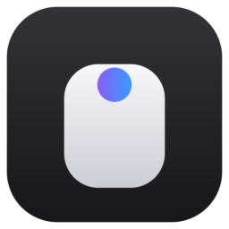
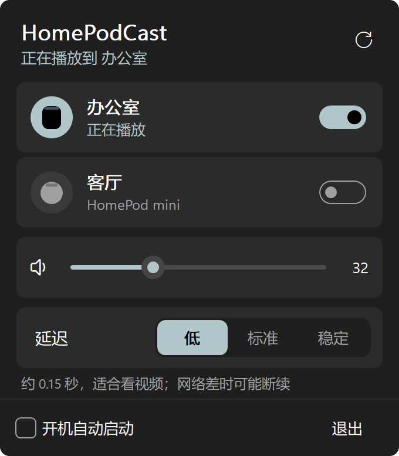
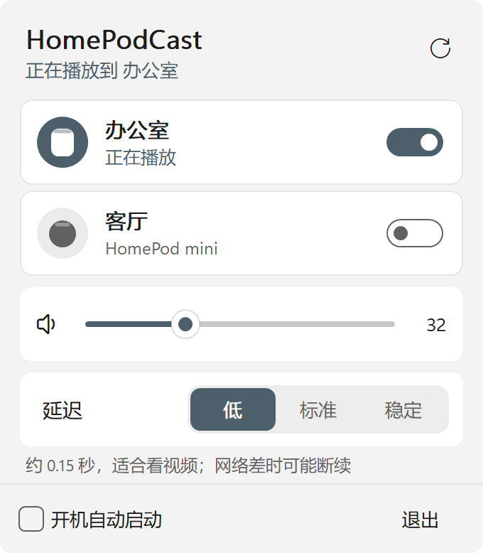
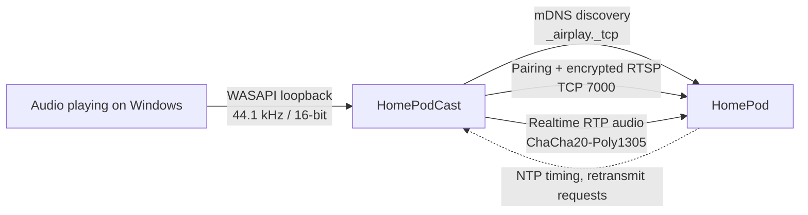

<p align="center">
  
</p>

<h1 align="center">HomePodCast</h1>

<p align="center">
  Stream everything your Windows PC plays to a HomePod over AirPlay 2, in real time.<br>
  One 2 MB exe. No runtime to install, no internet access, no telemetry.
</p>

<p align="center">
  <a href="LICENSE"></a>
  
  
  
  
  
</p>

<p align="center">
  <a href="https://github.com/ruoyu-lab/homepod-cast/releases/latest"><b>Download</b></a> ·
  <a href="#features">Features</a> ·
  <a href="#latency">Latency</a> ·
  <a href="#how-it-works">How it works</a> ·
  <a href="#building-from-source">Build</a> ·
  <a href="README.md">中文</a>
</p>

---

<p align="center">
  
  &nbsp;&nbsp;
  
</p>

> The interface is in Chinese for now.

## Features

**One click**: HomePodCast lives in the notification area. Open the panel and every HomePod on your network is already listed;
flip a switch and whatever the PC is playing — music, video, games, system sounds — comes out of the HomePod.

**Remembers you**: reconnects to the last HomePod you used on launch; with "start at sign-in" enabled there is nothing to click at all.

**The panel**

- Volume controls the HomePod itself — drag the slider or scroll anywhere on the panel
- Three latency presets: Low (~0.15 s), Normal (~0.3 s), Stable (~0.8 s)
- Follows the system light/dark theme and accent color, crisp on high-DPI displays
- Follows the default playback device when you switch it (e.g. plugging in headphones)

**Recovers on its own**: if a network hiccup drops the connection, it reconnects automatically.

## Download

| OS | Requirements | Download |
| --- | --- | --- |
| Windows | Windows 11, 64-bit | [Releases](https://github.com/ruoyu-lab/homepod-cast/releases/latest) |

Download `HomePodCast.exe`, put it somewhere permanent and run it — there is no installer.

> The binary is not code-signed. If SmartScreen says "Windows protected your PC", click "More info › Run anyway".

**Firewall prompt on first connect**: the HomePod connects back to the PC for clock synchronization, which Windows Firewall blocks by default.
When that happens the panel shows an "allow and reconnect" button; it asks for UAC consent once and adds a single inbound rule
for this exe, limited to private networks.

## Latency

AirPlay 2 is built for synchronized multi-room playback, not low latency: the HomePod itself buffers 80+ ms before playing anything.
HomePodCast adds only as much buffering as it needs on top of that:

| Preset | Approx. latency | Good for |
| --- | --- | --- |
| Low | 0.15 s | Video; may stutter on weak Wi-Fi |
| Normal | 0.3 s | Most uses |
| Stable | 0.8 s | Music only, practically never drops |

Apple devices delay the video to line up with AirPlay audio; Windows players don't know about the delay, so video sound lags slightly —
the same as with every other AirPlay sender for Windows.

## Security & privacy

- **Offline**: talks only to HomePods on your local network. No servers, no analytics, no auto-update
- **Zero dependencies**: pairing, encryption, discovery and audio capture are all implemented in this repository
- **Encrypted end to end**: keys come from HomeKit pairing (SRP-6a); the control channel and the audio are encrypted with ChaCha20-Poly1305
- **Leaves no mess**: settings are one text file, `%APPDATA%\HomePodCast\settings.ini`; start-at-sign-in is a per-user `Run` registry value.
  No admin rights needed — the firewall rule is the only system change, and you confirm it yourself

## FAQ

**No HomePod in the list**: make sure the PC and the HomePod are on the same network. VPNs and routers with client isolation block discovery.

**"The device refused pairing"**: in the Home app on iPhone, open Home Settings › Speakers & TV and set "Allow Speaker & TV Access" to
"Anyone on the Same Network" or "Everyone".

**The PC speakers play too**: HomePodCast captures what the default playback device is playing, so it still plays locally. Turn its volume down.

## How it works



1. **Discovery**: an mDNS query for `_airplay._tcp`, filtered by model (`AudioAccessory*`)
2. **Pairing**: HomePods support transient pairing — HomeKit SRP-6a with a fixed PIN gives both sides a session key; HKDF derives per-channel keys
3. **Session**: two `SETUP` requests (binary plists) over encrypted RTSP — one for the session and event channel, one for a realtime PCM stream (352 frames per packet)
4. **Streaming**: an encrypted RTP packet every 8 ms, paced by a high-resolution clock; a sync packet every second maps timestamps to wall-clock time;
   lost packets are resent from a 1024-packet backlog on request
5. **Capture**: WASAPI loopback gets the system mix, converted by Windows to 44.1 kHz / 16-bit and byte-swapped to big-endian as AirPlay expects

The protocol work follows [pyatv](https://github.com/postlund/pyatv); this is an independent C# implementation.

## Building from source

Requires the [.NET 10 SDK](https://dotnet.microsoft.com/download) and the "Desktop development with C++" workload from Visual Studio 2022 or later (Native AOT needs its linker).

```bat
git clone https://github.com/ruoyu-lab/homepod-cast.git
cd homepod-cast
dotnet publish -c Release -r win-x64 -o dist
```

The result is a single file, `dist\HomePodCast.exe`. Handy command-line switches for development:

```bat
HomePodCast.exe --scan                         :: list HomePods on the network
HomePodCast.exe --test 192.168.1.20 10 300     :: stream system audio for 10 s at 300 ms latency
HomePodCast.exe --test 192.168.1.20 5 300 tone :: stream a 440 Hz test tone for 5 s
HomePodCast.exe --render docs\images           :: render the panel to PNG (the screenshots above)
```

Set `HPC_DEBUG=1` to print debug logs (such as retransmit requests) to the console.

## Layout

```text
src/Protocol/   AirPlay 2: mDNS, HAP transient pairing (SRP-6a), TLV8, binary plist, encrypted RTSP, realtime RTP
src/Audio/      WASAPI loopback capture (raw COM vtables) and a ring buffer
src/UI/         Tray icon and the custom-drawn panel (Win32 + GDI+), theming, firewall consent
src/            Entry point, app state, settings, developer commands
tools/          Icon generator (Python standard library only)
docs/images/    Images used by the README
```

## License

HomePodCast is released under the [MIT License](LICENSE).

AirPlay and HomePod are trademarks of Apple Inc. This is an independent open-source project, not affiliated with or endorsed by Apple.
