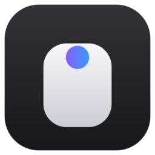
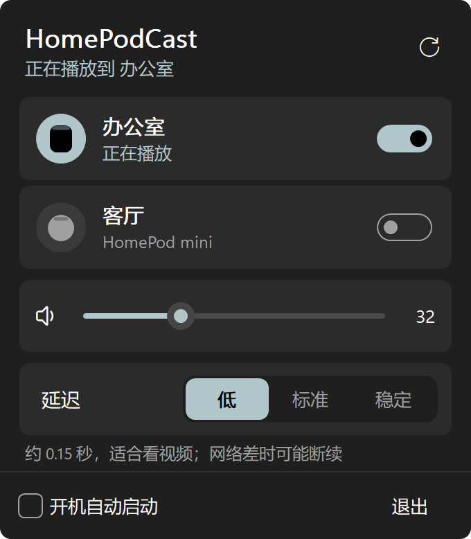
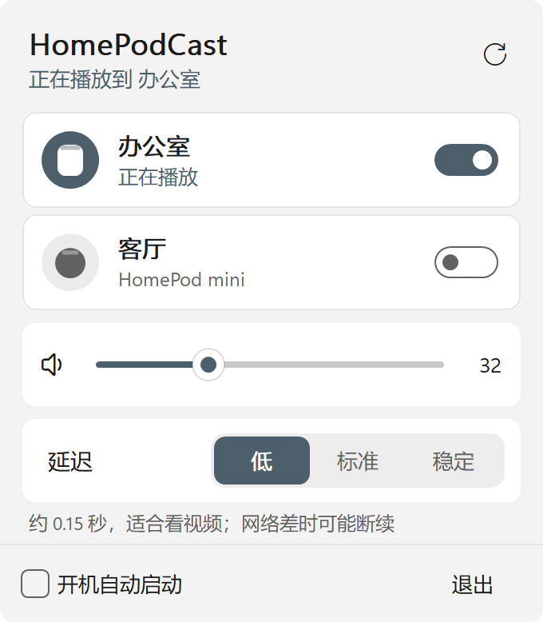
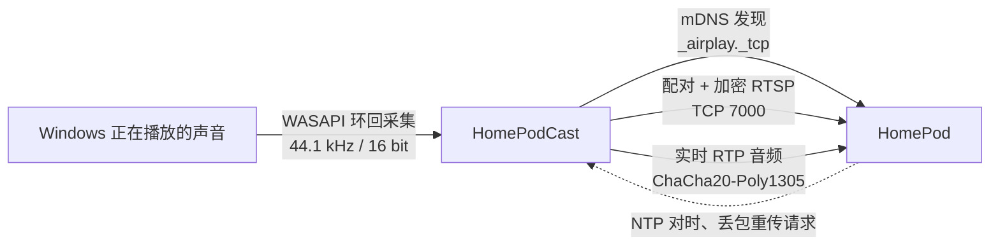

<p align="center">
  
</p>

<h1 align="center">HomePodCast</h1>

<p align="center">
  把 Windows 电脑的声音，通过 AirPlay 2 实时推到 HomePod。<br>
  一个 2 MB 的 exe，点一下就响，不装运行时、不联网、不收集任何东西。
</p>

<p align="center">
  <a href="LICENSE"></a>
  
  
  
  
  
</p>

<p align="center">
  <a href="https://github.com/ruoyu-lab/homepod-cast/releases/latest"><b>下载</b></a> ·
  <a href="#功能">功能</a> ·
  <a href="#关于延迟">关于延迟</a> ·
  <a href="#工作原理">工作原理</a> ·
  <a href="#从源码编译">从源码编译</a> ·
  <a href="README.en.md">English</a>
</p>

---

<p align="center">
  
  &nbsp;&nbsp;
  
</p>

## 功能

**点一下就响**：常驻在任务栏右下角，点开面板，局域网里的 HomePod 自己出现在列表里，打开开关就开始播放；
电脑上放什么，HomePod 就响什么：音乐、视频、游戏、系统提示音都算。

**记得你**：下次打开自动连回上次用的那台 HomePod；勾上"开机自动启动"，开机后什么都不用点。

**面板**

- 音量直接调 HomePod 本身，拖滑块或者在面板上滚滚轮都行
- 延迟三档：低（约 0.15 秒）、标准（约 0.3 秒）、稳定（约 0.8 秒）
- 跟随系统的深色、浅色和强调色，高分屏下清晰
- 切换电脑的默认播放设备（比如插上耳机）后，会自动跟着采集新设备的声音

**断了会接上**：网络抖一下导致断开时，会自动重新连接。

## 下载

| 系统 | 要求 | 下载 |
| --- | --- | --- |
| Windows | Windows 11，64 位 | [Releases](https://github.com/ruoyu-lab/homepod-cast/releases/latest) |

下载 `HomePodCast.exe`，放到一个固定的位置（比如 `D:\Tools\HomePodCast\`），双击运行，不需要安装。

> 程序没有付费的代码签名证书，第一次运行时如果弹出"Windows 已保护你的电脑"，点"更多信息 › 仍要运行"。

**第一次连接时的防火墙提示**：HomePod 需要回连电脑做时钟同步，Windows 防火墙默认会拦下。
被拦时面板里会出现"允许并重新连接"按钮，点了之后弹出系统的 UAC 确认，点"是"即可。
它只做一件事：为这个 exe 加一条入站放行规则，而且只在专用网络（家庭、公司）下生效。

## 关于延迟

AirPlay 2 是为多房间同步播放设计的，本身不是低延迟协议：HomePod 收到声音后，自己还要缓冲 80 多毫秒再放出来，
这一段谁都绕不过去。HomePodCast 在这之上只多留了够用的缓冲：

| 档位 | 大约延迟 | 适合 |
| --- | --- | --- |
| 低 | 0.15 秒 | 看视频；Wi-Fi 信号差时可能断续 |
| 标准 | 0.3 秒 | 大多数情况 |
| 稳定 | 0.8 秒 | 只听音乐，几乎不会断 |

苹果自己的设备投到 HomePod 时，播放器会把画面推迟来对齐声音；Windows 上的播放器不知道有这层延迟，
所以看视频时会觉得声音慢半拍，这和市面上同类工具是一样的。

## 安全和隐私

- **不联网**：只和同一个局域网里的 HomePod 通信，没有服务器、没有统计、没有自动更新
- **零依赖**：配对、加密、设备发现、声音采集全部是这个仓库里的源码，没有引入任何第三方库
- **全程加密**：和 HomePod 之间用 HomeKit 的配对协议（SRP-6a）建立密钥，控制通道和音频都用 ChaCha20-Poly1305 加密
- **不留痕迹**：设置只有 `%APPDATA%\HomePodCast\settings.ini` 一个文本文件；开机自启写在当前用户的 `Run` 注册表项里，
  取消勾选就删掉；不需要管理员权限，防火墙规则是唯一一次需要你确认的系统改动

## 常见问题

**列表里找不到 HomePod**：确认电脑和 HomePod 在同一个网络；连了 VPN 或者开了"访客网络隔离"的路由器会挡住设备发现。

**提示"设备拒绝了配对"**：在 iPhone 的"家庭"App 里，打开 家庭设置 › 扬声器与电视，
把"允许访问"设为"同一网络中的任何人"或"所有人"。

**电脑扬声器也在响**：HomePodCast 采集的是默认播放设备正在播放的声音，所以电脑自己的扬声器也会同时出声，可以把它的音量调低。

## 工作原理



1. **发现**：用 mDNS 查询局域网里的 `_airplay._tcp` 服务，按型号（`AudioAccessory*`）筛出 HomePod
2. **配对**：HomePod 支持"临时配对"：用固定 PIN 跑一遍 HomeKit 的 SRP-6a，双方得到同一个会话密钥，再用 HKDF 派生出各通道的密钥
3. **建立会话**：在加密的 RTSP 连接上发两次 `SETUP`（二进制 plist），一次建会话和事件通道，一次建实时音频流（PCM、每包 352 帧）
4. **推流**：按高精度时钟的节拍，每 8 毫秒发一个加密的 RTP 包；每秒发一次同步包，告诉 HomePod 每个时间戳该在什么时刻播出；
   HomePod 发现丢包时请求重传，从最近 1024 个包的缓存里补发
5. **采集**：WASAPI 环回模式直接拿到系统混音后的声音，由 Windows 转换成 44.1 kHz / 16 bit，发送前转成 AirPlay 要求的大端字节序

协议细节参考了 [pyatv](https://github.com/postlund/pyatv) 的实现，这里是用 C# 独立重写的。

## 从源码编译

需要 [.NET 10 SDK](https://dotnet.microsoft.com/download)，以及 Visual Studio 2022 或更新版本的"使用 C++ 的桌面开发"组件（原生 AOT 编译要用到它的链接器）。

```bat
git clone https://github.com/ruoyu-lab/homepod-cast.git
cd homepod-cast
dotnet publish -c Release -r win-x64 -o dist
```

编译出来就是 `dist\HomePodCast.exe` 一个文件。开发调试时可以用这几个命令行参数：

```bat
HomePodCast.exe --scan                         :: 列出局域网里的 HomePod
HomePodCast.exe --test 192.168.1.20 10 300     :: 推 10 秒系统声音，延迟 300 毫秒
HomePodCast.exe --test 192.168.1.20 5 300 tone :: 推 5 秒 440 Hz 测试音
HomePodCast.exe --render docs\images           :: 把面板渲染成 PNG（就是上面的截图）
```

设置环境变量 `HPC_DEBUG=1` 会在控制台输出调试日志（比如 HomePod 的重传请求）。

## 目录

```text
src/Protocol/   AirPlay 2：mDNS 发现、HAP 临时配对（SRP-6a）、TLV8、二进制 plist、加密 RTSP、实时 RTP 推流
src/Audio/      WASAPI 环回采集（直接调用 COM 虚表）、环形缓冲
src/UI/         托盘图标和自绘面板（Win32 + GDI+）、主题、防火墙授权
src/            程序入口、状态管理、设置、开发用的命令行
tools/          生成图标的脚本（只用 Python 标准库）
docs/images/    README 用的图片
```

## 许可

HomePodCast 以 [MIT License](LICENSE) 发布。

AirPlay、HomePod 是 Apple Inc. 的商标。本项目是独立开发的开源软件，与 Apple 没有关联，也没有得到 Apple 的认可。
